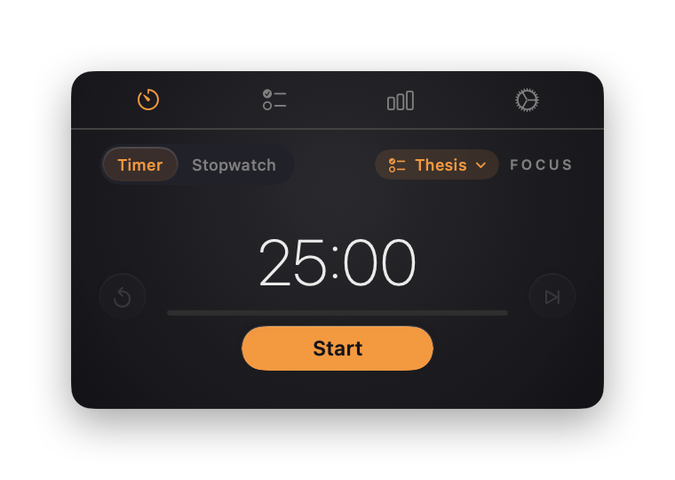
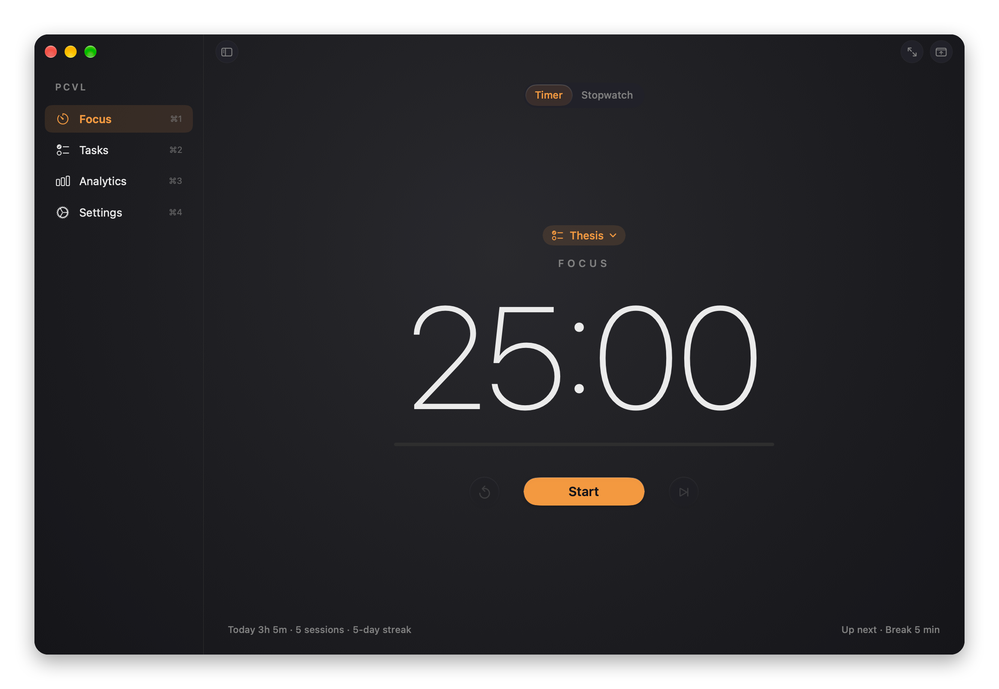
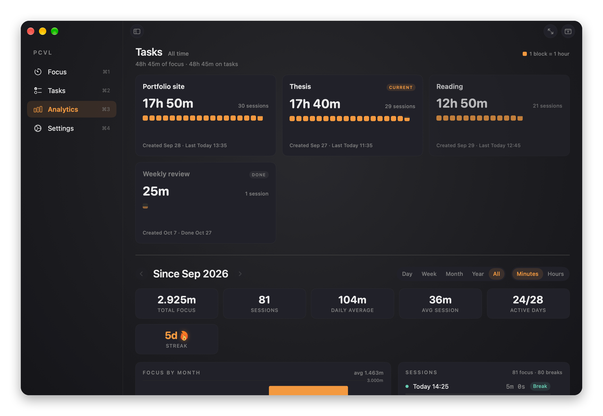
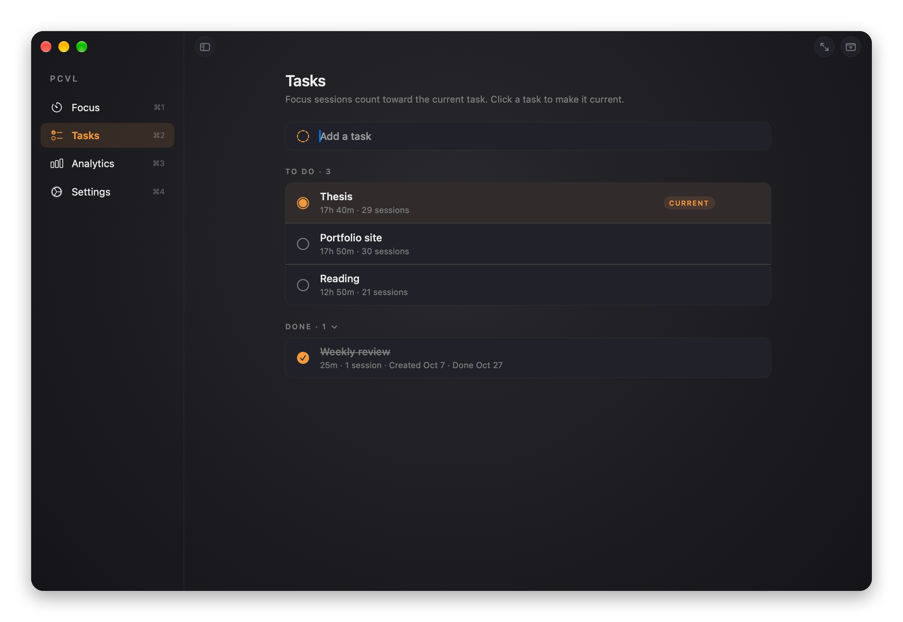
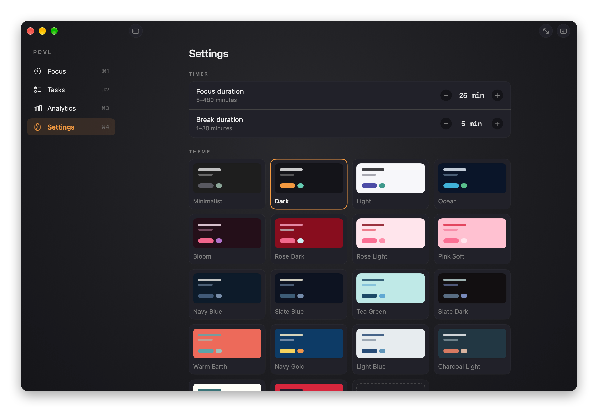

<p align="center">
  
</p>

<h1 align="center">PCVL</h1>

<p align="center">
  A focus timer that lives in your menu bar.<br>
  Pomodoro and stopwatch sessions, tasks, analytics and themes, all stored on your Mac.
</p>

<p align="center">
  <a href="https://github.com/metetuy/PCVL/releases/latest"><b>Download the latest version</b></a>
</p>

<p align="center">
  
</p>

## Features

- **Lives in the menu bar.** A small panel opens from the menu bar icon, with no Dock icon. You can show the remaining time next to the icon and keep the panel on top of other windows.
- **Pomodoro and stopwatch.** Focus and break phases with configurable durations, or an open-ended stopwatch. Scroll over the time to adjust it, and get a sound and a notification when a phase ends.
- **Tasks.** Pick the task you're working on, and every focus session counts toward it. You can see how much time each task took.
- **Analytics.** Day, week, month, year and all-time charts. Also: streaks, best day, peak hours, average session length and a card for each task.
- **Themes.** A set of built-in color themes, or create your own in the theme editor. Choose between the system font and Inter.
- **Desktop window.** Expand the panel into a resizable window with Focus, Tasks, Analytics and Settings screens. It supports full screen.
- **Updates itself.** New versions install from inside the app (Settings › Updates).
- **Private.** Your sessions and tasks never leave your Mac.

## Screenshots



<table>
  <tr>
    <td></td>
    <td></td>
  </tr>
  <tr>
    <td align="center">Analytics</td>
    <td align="center">Tasks</td>
  </tr>
  <tr>
    <td colspan="2"></td>
  </tr>
  <tr>
    <td colspan="2" align="center">Settings and themes</td>
  </tr>
</table>

## Installation

1. Download **PCVL-x.y.dmg** from the [latest release](https://github.com/metetuy/PCVL/releases/latest).
2. Open it and drag **PCVL** into **Applications**.
3. Open PCVL from Applications. Its icon appears in the menu bar.

PCVL isn't notarized by Apple, so the first launch is blocked. To allow it, go to **System Settings › Privacy & Security** and click **Open Anyway** next to the message about PCVL. You only need to do this once; updates install without it.

**Requirements:** macOS 26.1 or later, on an Apple silicon or Intel Mac.

## Usage

| | |
|---|---|
| Open the panel | Click the menu bar icon |
| Quick settings, task, theme, updates | Right-click the menu bar icon |
| Switch panel tabs | Click the tab icons, or swipe horizontally on the trackpad |
| Open the desktop window | Hover over the bottom of the panel and click **Expand for details** |
| Window sections | ⌘1 Focus · ⌘2 Tasks · ⌘3 Analytics · ⌘4 Settings |
| Start / pause (Focus screen) | Space |
| Toggle the sidebar / full screen | ⌃⌘S / ⌃⌘F |

## Updates

PCVL checks this repository's releases once a day and tells you when a new version is out. You can also check yourself in **Settings › Updates** or from the right-click menu.

Every update is signed. The app verifies the signature before installing and refuses any download that doesn't match. Your sessions, tasks and settings are kept across updates.

## Your data

Everything stays on your Mac:

- **Sessions and tasks:** `~/Library/Application Support/default.store`
- **Settings and themes:** `~/Library/Preferences/pomodoro.PCVL.plist`

The only thing PCVL sends over the network is the daily update check to GitHub. You can turn that off in **Settings › Updates**. You can export your sessions as JSON from Settings.

## Building from source

Requires Xcode 27. The project has no external dependencies.

```sh
git clone https://github.com/metetuy/PCVL.git
cd PCVL
open PCVL.xcodeproj   # then ⌘R
```

Run the tests with ⌘U, or:

```sh
xcodebuild test -scheme PCVL
```

To refresh the screenshots in this README, run:

```sh
TEST_RUNNER_PCVL_SCREENSHOTS=1 xcodebuild test -scheme PCVL -only-testing:PCVLTests/ReadmeScreenshots
```

The screenshots are rendered from the real app with sample data.

## Releasing

1. Raise **Version** (and **Build**) in Xcode.
2. Push to `main`.

GitHub Actions then builds the app and publishes `v<version>` with the DMG and the signed update. Pushes that keep the version don't release anything. To build locally, run `scripts/release.sh`, or `scripts/release.sh --dmg-only` to preview just the DMG.
